<div align="center">

# Vodeo

Plataforma de streaming de vídeo bajo demanda (VOD) con arquitectura de microservicios, transcodificación asíncrona y reproducción adaptativa HLS.


Trabajo de Fin de Grado del Grado en Ingeniería Informática (mención en Ingeniería del Software), Facultade de Informática, Universidade da Coruña. Calificación: 9.

</div>

<p align="center">
  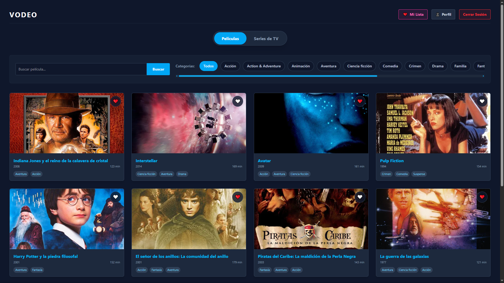
</p>

## Sobre el proyecto

Este proyecto parte de mi interés por entender cómo funciona el streaming de vídeo por dentro, más allá de darle al play. Para ello construí una plataforma completa desde cero.

En una aplicación monolítica, una tarea pesada como transcodificar un vídeo puede saturar el servidor y empeorar la experiencia de todos los demás usuarios. Aquí cada responsabilidad vive en un microservicio independiente y el procesamiento de vídeo se desacopla mediante mensajería asíncrona, de modo que subir un archivo grande no afecta a quien está navegando por el catálogo o viendo una película.

La memoria completa del TFG (105 páginas con análisis, diseño, implementación y pruebas) está en [`docs/TFG_Alexandre_Fernandez_Fernandez.pdf`](docs/TFG_Alexandre_Fernandez_Fernandez.pdf).

## Funcionalidades

Para el usuario:

- Registro e inicio de sesión con autenticación JWT sin estado y dos roles (`USER` y `ADMIN`).
- Catálogo de películas y series con paginación, búsqueda difusa (tolera erratas) y filtro por género.
- Reproducción adaptativa: la calidad cambia en tiempo real entre 1080p, 720p y 480p según el ancho de banda.
- Subtítulos en varios idiomas (WebVTT).
- "Seguir viendo" con seguimiento del progreso, y reproducción automática del siguiente episodio, incluso al cambiar de temporada.
- "Mi Lista" mixta de películas y series, reseñas con valoración y recomendaciones basadas en el historial.
- Perfil de usuario con cambio de contraseña.

Para el administrador:

- Alta de películas y series con importación automática de metadatos (TMDB, con OMDb como respaldo), que se pueden corregir a mano.
- Gestor de temporadas y episodios, con autocompletado desde TMDB, subida de vídeo y de subtítulos.
- Gestión de usuarios y panel con métricas.
- Moderación de reseñas.

## Capturas

Selección de pantallas. La memoria recoge toda la interfaz en el capítulo 7.

<table>
  <tr>
    <td width="50%">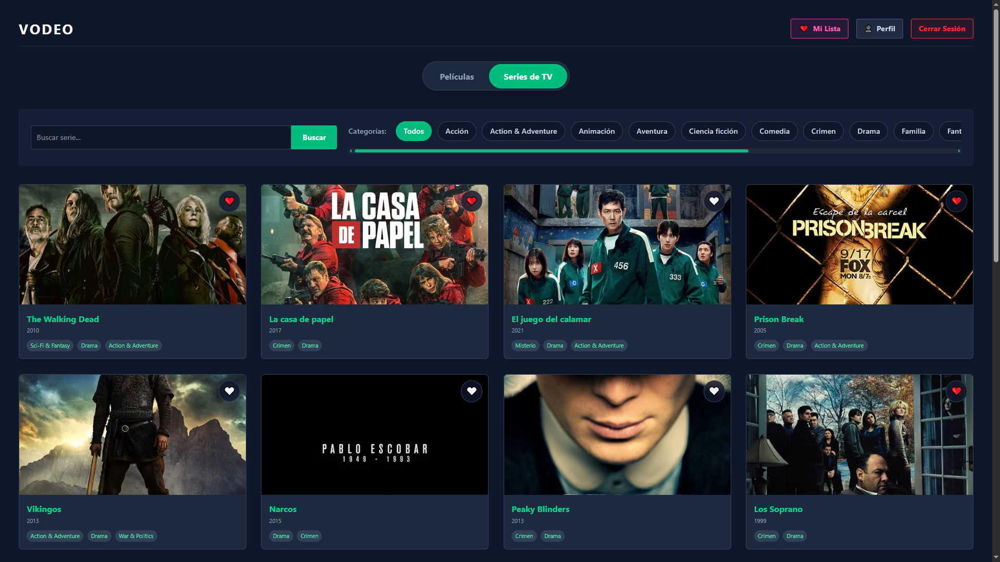<br><sub>Catálogo de series. La interfaz cambia de color según el tipo de contenido.</sub></td>
    <td width="50%">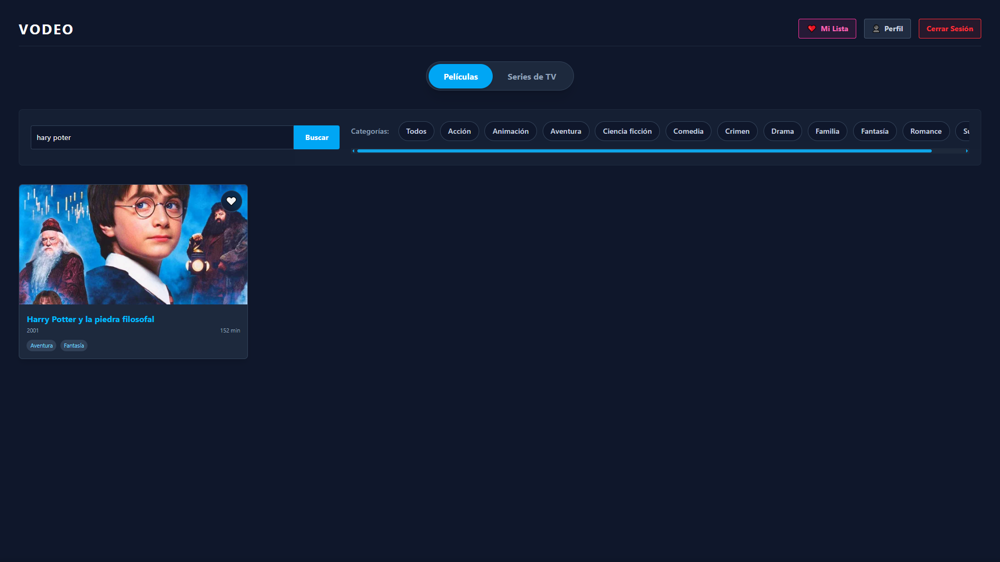<br><sub>Búsqueda difusa: "hary poter" encuentra Harry Potter (pg_trgm).</sub></td>
  </tr>
  <tr>
    <td>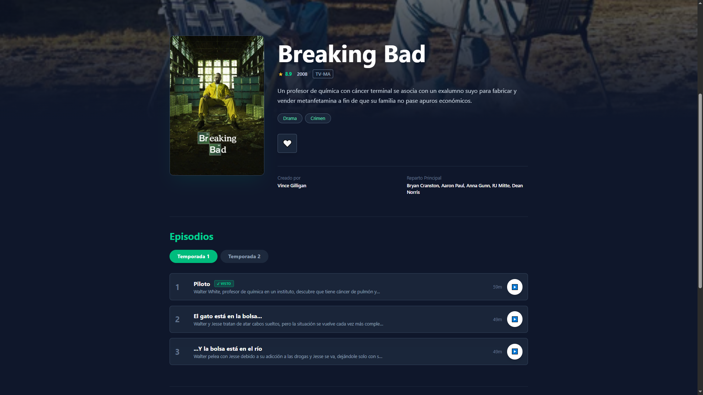<br><sub>Ficha de serie con temporadas y episodios vistos.</sub></td>
    <td>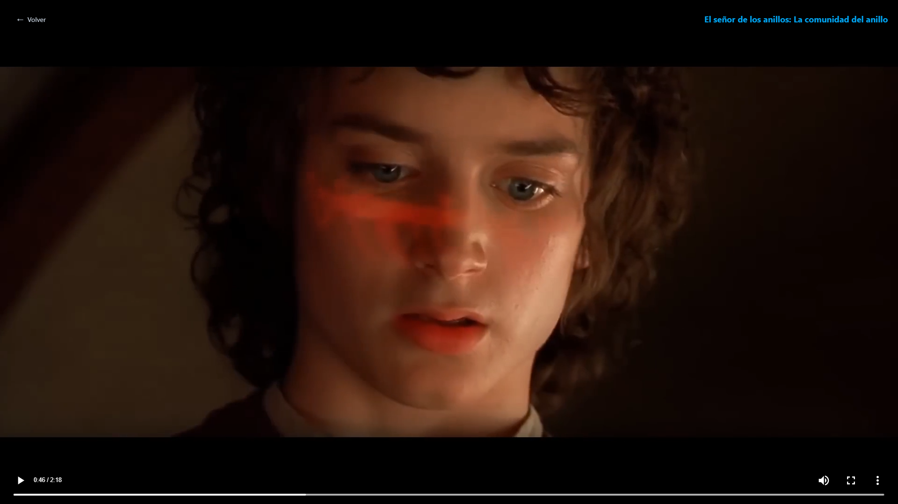<br><sub>Reproductor adaptativo (HLS con hls.js).</sub></td>
  </tr>
  <tr>
    <td>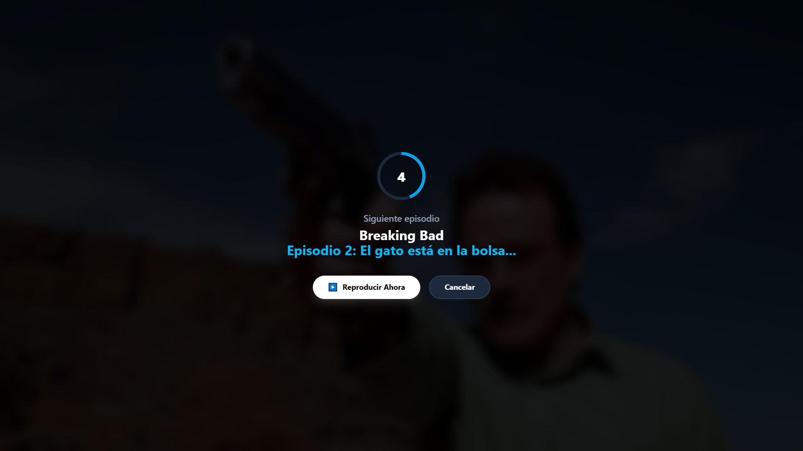<br><sub>Aviso de reproducción automática del siguiente episodio.</sub></td>
    <td>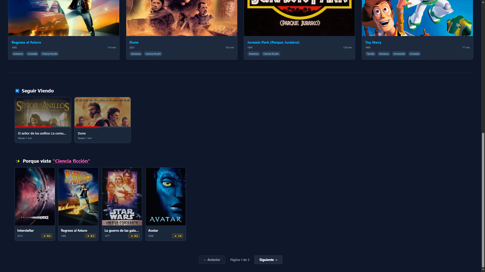<br><sub>"Seguir viendo" y recomendaciones por género.</sub></td>
  </tr>
  <tr>
    <td>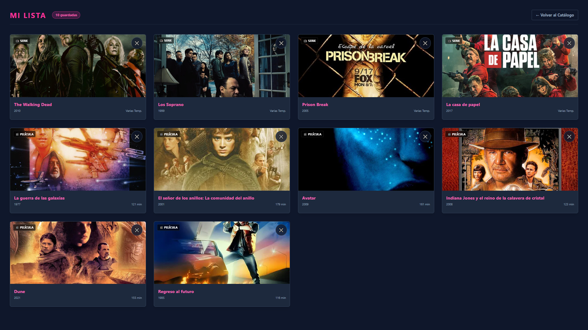<br><sub>"Mi Lista" con películas y series.</sub></td>
    <td>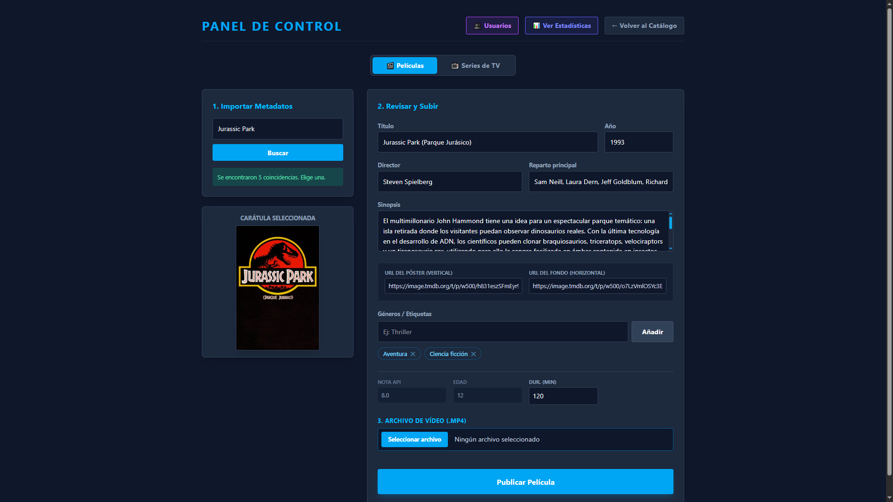<br><sub>Panel de administración: alta de película con importación desde TMDB.</sub></td>
  </tr>
  <tr>
    <td>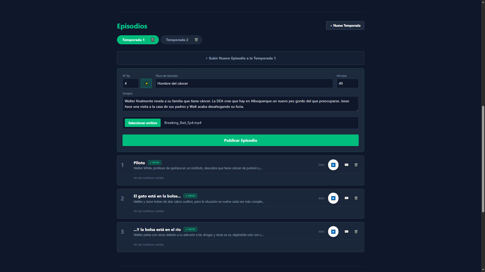<br><sub>Gestor de temporadas y episodios, con autocompletado desde TMDB.</sub></td>
    <td>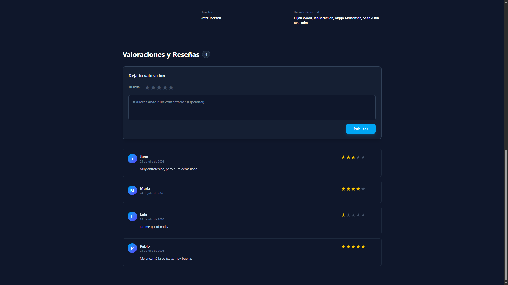<br><sub>Valoraciones y reseñas de una película.</sub></td>
  </tr>
</table>

## Arquitectura

<p align="center">
  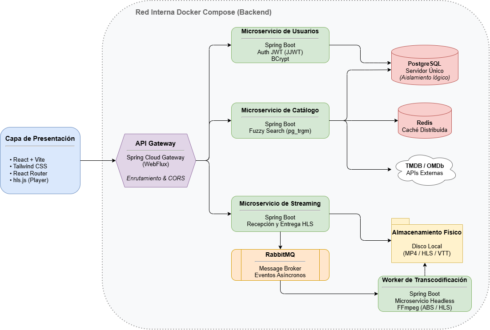
</p>

| Servicio | Responsabilidad |
| :--- | :--- |
| `api-gateway` | Punto de entrada único. Enrutado y gestión centralizada de CORS. Oculta la estructura interna al cliente. |
| `users-service` | Registro, login, emisión de JWT, perfil, Mi Lista, historial de reproducción y gestión de usuarios. |
| `catalog-service` | Películas, series, temporadas, episodios, géneros, reseñas y subtítulos. Integración con TMDB y OMDb. Caché con Redis. |
| `streaming-service` | Recepción de vídeo, publicación de eventos y entrega de segmentos HLS y subtítulos VTT. |
| `transcoding-service` | Worker sin API pública. Consume eventos de RabbitMQ y transcodifica con FFmpeg a HLS en varias resoluciones. |
| `frontend` | SPA en React con rutas protegidas por rol. |

Hay un único servidor PostgreSQL compartido por `users-service` y `catalog-service`, pero con aislamiento lógico a nivel de tablas: no hay claves foráneas ni consultas cruzadas entre los dos dominios. Cuando hace falta combinar datos de ambos (por ejemplo en Mi Lista), lo hace el cliente.

### Flujo de subida y procesamiento de vídeo

1. El administrador sube un `.mp4` al `streaming-service`, que lo escribe en disco de forma secuencial, sin cargarlo entero en memoria, y responde de inmediato.
2. El servicio publica un `VideoEvent` en RabbitMQ con la ruta del fichero.
3. El `transcoding-service` consume el evento y lanza FFmpeg en una sola pasada (`-filter_complex`), generando tres calidades y un índice maestro `master.m3u8`. Al terminar borra el archivo original.
4. El reproductor (`hls.js`) estima el ancho de banda y elige la calidad en cada momento.

## Decisiones técnicas

Todas están explicadas con más detalle, con diagramas y fragmentos de código, en los capítulos 5 y 6 de la memoria.

- **Transcodificación asíncrona con RabbitMQ y FFmpeg.** Subir un vídeo no bloquea los hilos HTTP: el `streaming-service` publica un evento y el worker transcodifica aparte, por lo que se puede escalar por separado. FFmpeg se lanza desde Java con un único comando (`split=3`) que genera las tres calidades. Su salida se lee con un `BufferedReader` antes de `waitFor()`, para que el búfer del sistema operativo no se llene y deje el proceso bloqueado.
- **Consistencia entre servicios con eventos.** Al borrar contenido o cuentas, los servicios publican `MediaDeletedEvent`, `UserDeletedEvent` o `FileDeletedEvent`, y los demás eliminan datos y archivos (`.ts`, `.vtt`) sin llamadas HTTP entre servicios. Las reseñas de una cuenta eliminada se anonimizan para cumplir con el RGPD.
- **Caché con Redis (Cache-Aside).** `@Cacheable` en las lecturas frecuentes del catálogo e invalidación con `@CacheEvict` al crear o borrar contenido.
- **Rendimiento de las consultas.** Las consultas N+1 se resuelven con `@EntityGraph`, y `MultipleBagFetchException` se evita cargando temporadas y episodios por separado, solo cuando se necesitan.
- **Búsqueda difusa con `pg_trgm`.** Consultas nativas paginadas con `similarity()`, ordenadas por relevancia en la propia base de datos. La extensión se activa al crear el contenedor.
- **JWT sin estado y autenticación en el reproductor.** El token se valida en cada servicio de forma independiente. El elemento `<video>` de HTML5 no permite cabeceras personalizadas, pero con `hls.js` el token se envía en la cabecera `Authorization` mediante `xhrSetup`, así que no aparece en la URL. Solo viaja como parámetro (`?token=`) en las pistas de subtítulos (`<track>`) y en Safari, que reproduce HLS de forma nativa sin `hls.js`.
- **Composición de API en el cliente.** Mi Lista, Seguir viendo y Recomendaciones combinan los identificadores de `users-service` con peticiones por lote a `catalog-service`, porque cada servicio es dueño de sus datos y no hay consultas cruzadas entre ellos.

## Stack tecnológico

| Capa | Tecnologías |
| :--- | :--- |
| Backend | Java 17, Spring Boot 3.5, Spring Security 6, Spring Data JPA y Hibernate, Spring AMQP, Spring Cloud Gateway, JJWT, SpringDoc OpenAPI |
| Frontend | React 19, Vite, Tailwind CSS 4, React Router, Axios, hls.js, jwt-decode, react-hot-toast |
| Datos | PostgreSQL 15 (con `pg_trgm`), Redis 7 |
| Mensajería | RabbitMQ |
| Vídeo | FFmpeg, HLS, WebVTT |
| Infraestructura | Docker y Docker Compose (volúmenes persistentes y *bind mounts*) |
| Pruebas | JUnit 5, Mockito, `@DataJpaTest` con H2, Postman |
| Metodología | Kanban con GitHub Projects, ramas por funcionalidad, issues y pull requests |

## Puesta en marcha

### Requisitos

- Docker y Docker Compose.
- Una API key de [TMDB](https://www.themoviedb.org/settings/api) y otra de [OMDb](https://www.omdbapi.com/apikey.aspx). Las dos son gratuitas.

### Con Docker Compose

```bash
git clone https://github.com/alexandrefdez/vodeo.git
cd vodeo

# 1. Variables de entorno
cp .env.example .env
# Edita .env y rellena como mínimo JWT_SECRET, TMDB_API_KEY y OMDB_API_KEY

# 2. Arrancar todo el sistema
docker compose up --build
```

| Variable | Descripción |
| :--- | :--- |
| `JWT_SECRET` | Clave de firma de los tokens, codificada en Base64 y de al menos 32 bytes. Se genera con `openssl rand -base64 48`. Obligatoria. |
| `TMDB_API_KEY`, `OMDB_API_KEY` | Claves para la importación de metadatos. |
| `DB_USER`, `DB_PASSWORD` | Credenciales de PostgreSQL. Opcionales, con valor por defecto para desarrollo. |
| `VODEO_ADMIN_PASSWORD` | Contraseña del administrador inicial. Opcional, con valor por defecto para desarrollo. |

Cuando termine de arrancar:

| Recurso | URL |
| :--- | :--- |
| Aplicación web | http://localhost:3000 |
| API Gateway | http://localhost:8080 |
| RabbitMQ (gestión) | http://localhost:15672 |

En el primer arranque se crea la cuenta de administrador `admin@vodeo.com`, con la contraseña de `VODEO_ADMIN_PASSWORD`. Desde ahí se puede dar de alta contenido y subir vídeo.

Los valores por defecto de las credenciales son solo para desarrollo local. Hay que cambiarlos antes de exponer el sistema.

### Modo desarrollo híbrido

Para trabajar en un servicio concreto desde el IDE se puede levantar solo la infraestructura:

```bash
docker compose up postgres-db rabbitmq redis
```

Después se arranca cada servicio con `./mvnw spring-boot:run`, desde su carpeta, y el frontend con `npm run dev`. En este modo los servicios quedan accesibles directamente y Swagger UI está en `http://localhost:8081/swagger-ui.html` (`users-service`), `8082` (`catalog-service`) y `8083` (`streaming-service`). Para ejecutar `transcoding-service` fuera de Docker hace falta tener [FFmpeg](https://ffmpeg.org/download.html) instalado.

## Pruebas

- **Unitarias** (JUnit 5 y Mockito, en estilo BDD con `@DisplayName`): lógica de negocio de los servicios con las dependencias externas simuladas, incluida la construcción de los comandos de FFmpeg y la emisión de eventos.
- **De integración** (`@DataJpaTest` con H2 en memoria): repositorios JPA contra un esquema real, con consultas derivadas y nativas, `@EntityGraph`, restricciones de unicidad y borrados en cascada.
- **Manuales:** la API se probó con Postman (autenticación y permisos por rol) y se hicieron pruebas de aceptación sobre los casos de uso.

```bash
cd users-service && ./mvnw test
cd catalog-service && ./mvnw test
cd streaming-service && ./mvnw test
cd transcoding-service && ./mvnw test
```

En Windows se usa `mvnw.cmd test`. Los detalles están en el capítulo 6 de la memoria.

## Estructura del repositorio

```text
vodeo/
├── api-gateway/          # Spring Cloud Gateway
├── users-service/        # Usuarios, autenticación, favoritos e historial
├── catalog-service/      # Catálogo, reseñas, subtítulos, integración con TMDB y OMDb
├── streaming-service/    # Subida de vídeo y entrega de segmentos HLS
├── transcoding-service/  # Worker de FFmpeg (consumidor de RabbitMQ)
├── frontend/             # SPA en React
├── db-init/              # Inicialización de PostgreSQL (pg_trgm)
├── docs/                 # Memoria del TFG y capturas
├── docker-compose.yml
└── .env.example
```

## Gestión del proyecto

Trabajé con Kanban en GitHub Projects. Cada cambio partió de una issue, se desarrolló en su propia rama con commits convencionales y se integró en `main` mediante pull request, así que el historial del repositorio muestra todo el proceso. El proyecto duró 51 días naturales y unas 275 horas, frente a las 250 previstas. La diferencia se debe a la infraestructura de mensajería asíncrona, que no estaba en el plan inicial.

## Trabajo futuro

- Pruebas de integración con Testcontainers y pruebas end-to-end con Playwright o Cypress.
- Migrar el despliegue a Kubernetes para escalar el servicio de transcodificación por separado, y servir los segmentos desde una CDN.
- Recomendaciones por filtrado colaborativo.
- Varios perfiles por cuenta, avisos de contenido nuevo y sesiones de visionado sincronizadas.
- Aplicación móvil que reutilice el backend actual.

## Autor

Alexandre Fernández Fernández

Graduado en Ingeniería Informática (mención en Ingeniería del Software) por la Universidade da Coruña

GitHub: [@alexandrefdez](https://github.com/alexandrefdez)

Dirección del TFG: Miguel Rodríguez Penabad

## Licencia

- Código fuente: licencia [MIT](LICENSE).
- Memoria del TFG (`docs/`): [Creative Commons Reconocimiento-NoComercial-SinObraDerivada 4.0 Internacional](https://creativecommons.org/licenses/by-nc-nd/4.0/deed.es), la misma con la que se depositó en el Repositorio da Universidade da Coruña (RUC).

Este producto utiliza la API de [TMDB](https://www.themoviedb.org/) pero no está avalado ni certificado por TMDB. Como respaldo utiliza datos de [OMDb](https://www.omdbapi.com/).
